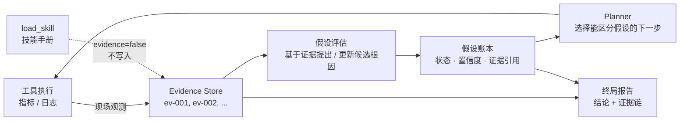
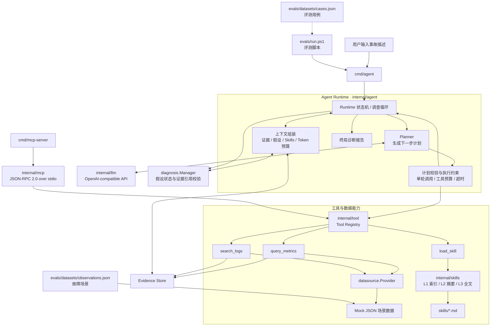
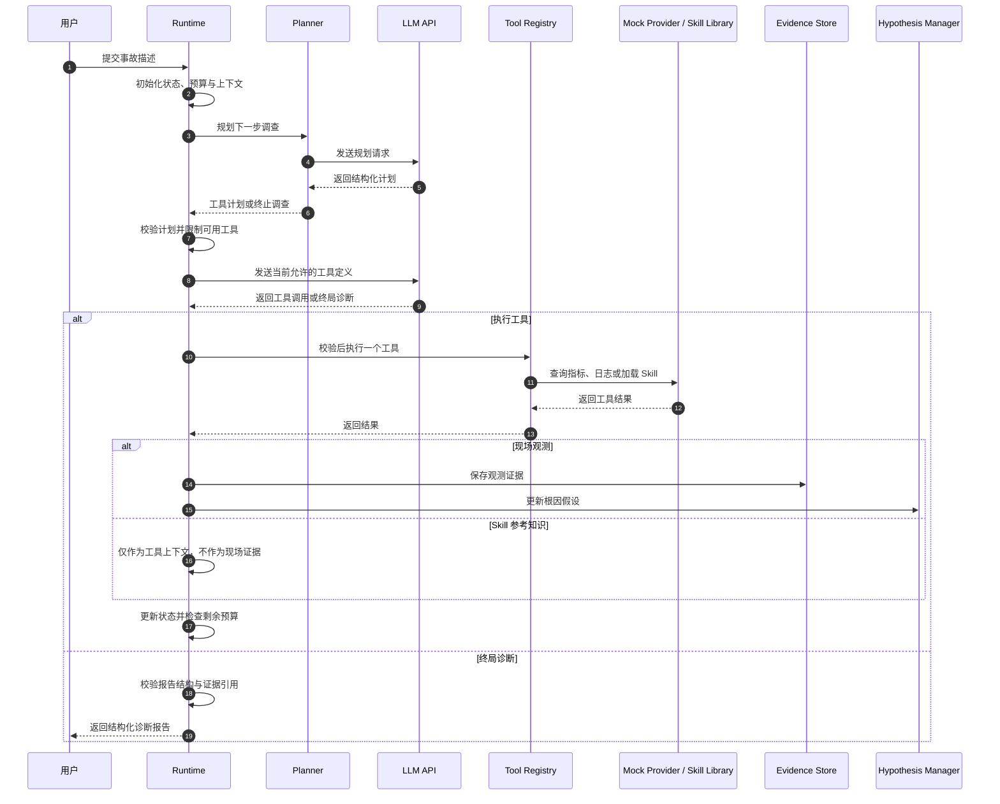

# TraceMind

> **TraceMind 是一个基于 Go 实现的证据驱动故障诊断 Agent。** 给定事故描述后，Agent 会规划调查步骤、调用日志与指标工具、维护结构化根因假设，并输出带证据引用、反证和未验证事项的诊断报告。

项目重点不是简单地把 LLM 接上几个工具，而是围绕 Agent 应用工程中的几个关键问题实现可运行的机制：**多轮调查闭环、工具调用约束、证据与参考知识隔离、渐进式 Skill 加载、预算控制、MCP 工具暴露，以及可重复的场景评测**。

- **语言：** Go 1.23
- **模型接口：** OpenAI-compatible Chat Completions，默认配置为 DeepSeek
- **工具调用：** Function Calling、自定义 Tool Registry、MCP stdio 子集
- **数据源：** 可插拔 `Provider` 接口，当前内置 JSON Mock Provider


## 核心能力

### 1. 多轮 Agent Runtime 与执行约束

- 手写 Go Runtime，不依赖通用 Agent 框架。
- 使用 `pending → planning → executing → observing → ... → completed/failed` 状态机记录调查生命周期。
- Planner 负责提出下一步计划，Runtime 负责校验并执行，分离模型决策与工具执行。
- 每轮最多执行一个工具调用；仅向模型暴露当前计划允许的工具。
- 工具执行失败同样计入调用预算；预算耗尽后不再开放工具，要求模型基于已有信息生成终局报告。
- 调查超时与 Context 取消信号传入规划器请求。

### 2. Evidence Store 与结构化根因假设

- 将日志、指标等工具返回的现场观测整理为可追溯 Evidence，并分配稳定的报告内证据 ID。
- 使用 `proposed / supported / refuted / inconclusive` 管理根因假设状态。
- 校验假设引用的证据 ID，拒绝引用不存在的证据。
- 对模型评估结果施加确定性约束：当支持证据与反驳证据同时存在时，将状态校正为 `inconclusive`，并限制置信度。
- 终局报告包含观察事实、支持证据、反驳证据、未验证事项、置信度与后续建议。

证据与假设在调查闭环中的流转：



**为什么这样设计？** 让结论从"模型生成的文本"变成"可回溯到证据 ID 的结构化判断"：

- **证据是事实，假设是解释**：证据来自工具观测，程序可验证其存在与来源；假设是候选根因，必须引用真实证据，状态与置信度受确定性约束。
- **三者各管一段**：程序校验引用合法性与状态规则，模型负责基于证据提出解释，评测负责检验最终结论。
- **好处**：每条结论都能回溯到证据 ID，报告可审计；"应该查什么"（技能知识）与"已经观察到什么"（现场证据）在数据模型层隔离，互不污染。

> 这些机制能够提高可追溯性和约束一致性，但不等于自动证明每个自然语言结论都被证据充分支持。当前评测中的证据质量检查主要验证引用合法性，语义级证据支持关系仍需进一步评估。

### 3. 渐进式 Skill 加载

技能文档位于 `skills/`，采用带 front matter 的 Markdown 格式，并分为三个加载层级：

| 层级  | 内容            | 加载方式                       |
| --- | ------------- | -------------------------- |
| L1  | 技能名称、描述与触发词索引 | 常驻上下文                      |
| L2  | 命中技能的摘要与推荐工具  | 根据事故描述和观测触发词匹配             |
| L3  | 完整排查手册        | 通过 `load_skill(name)` 按需加载 |

`load_skill` 作为普通工具参与计划校验和工具调用预算。Skill 属于参考知识，不应作为现场证据写入 Evidence Store。技能匹配目前使用大小写不敏感的包含匹配，尚未实现语义检索或同义词扩展。

### 4. LLM 调用韧性与预算治理

- 对部分网络错误、HTTP 429 和 5xx 响应进行有限次数的指数退避重试。
- 对规划输出异常提供降级路径；假设评估失败时尽量保留已有状态。
- 对常见非严格 JSON 输出进行修复，包括 Markdown 代码围栏、大写布尔值/`None` 和尾随逗号。
- 支持 `agent.max_tokens` 估算预算。估算器基于字符数近似计算，并非模型真实 tokenizer；超限时会尝试关闭工具调用并进入终局流程。

### 5. MCP 工具服务

项目实现了一个轻量的 MCP stdio 协议子集，支持 `initialize`、`notifications/initialized`、`ping`、`tools/list`、`tools/call` 和 `shutdown`。MCP 工具 Schema 由 Tool Registry 统一生成，避免 Function Calling 与 MCP 两套工具定义分叉。

当前 MCP Server 是独立进程，提供本地 stdio 工具访问；它不共享 Agent Runtime 的单次调查预算，也未实现远程 HTTP transport 或认证机制。

## 架构



### 一次调查如何运行



## 项目结构

```text
TraceMind/
├── cmd/
│   ├── agent/             # Agent 交互式调查入口
│   ├── mcp-server/        # MCP stdio 工具服务器
│   ├── tool/              # 单轮工具决策演示
│   ├── toolloopcheck/     # 多轮工具预算演示
│   └── llm/               # LLM 连通性冒烟测试
├── internal/
│   ├── agent/             # Runtime、Planner、工具执行、上下文与预算
│   ├── config/            # YAML 配置与本地密钥覆盖
│   ├── datasource/        # Provider 接口
│   │   └── mock/          # JSON 场景数据源
│   ├── diagnosis/         # 根因假设模型与管理器
│   ├── evidence/          # 证据模型与存储
│   ├── llm/               # OpenAI-compatible Chat Completions 客户端
│   ├── mcp/               # MCP stdio 协议子集
│   ├── skills/            # Skill 解析、匹配与加载管理
│   └── tool/              # 工具接口、注册表与内置工具
├── evals/
│   ├── datasets/          # 故障观测数据与评测用例
│   ├── results/           # 评测输出示例
│   └── run.ps1            # 批量评测与基线对照
├── skills/                # Markdown 排查手册
├── config.yaml            # 不含密钥的基础配置
└── go.mod
```

## 快速开始

### 环境要求

- Go 1.23 或更高版本
- 一个兼容 OpenAI Chat Completions API 的模型服务；默认配置为 DeepSeek

### 1. 配置模型 API Key

在项目根目录创建 `config.local.yaml`。该文件用于覆盖本地密钥，不要提交到 Git：

```yaml
llm:
  api_key: "替换成你的 API Key"
```

`config.yaml` 中包含默认的 `base_url`、`model` 和 Agent 参数。需要更换模型时，可修改对应配置。

### 2. 运行 Agent

```bash
go run ./cmd/agent
```

输入事故描述，例如：

```text
订单服务频繁超时，部分请求返回 HTTP 502
```

也可以直接传入事故描述和 Mock 场景：

```bash
go run ./cmd/agent -incident "订单服务频繁超时，部分请求返回 HTTP 502" -scenario connection_pool_exhaustion
```

当前场景数据由本地 Mock Provider 提供；模型仍需要可用的 API Key 和网络连接。

### 3. 运行其他演示

```bash
go run ./cmd/tool
go run ./cmd/toolloopcheck
go run ./cmd/llm
```

### 4. 启动 MCP Server

```bash
go run ./cmd/mcp-server -scenario connection_pool_exhaustion
```

MCP Server 使用 stdio 通信，启动后会等待客户端通过标准输入发送协议消息，因此在终端前台运行时看起来不会主动退出，这是预期行为。它应由支持 stdio 的 MCP 客户端启动。

### 5. 构建与测试

```bash
go build ./...
go test ./...
go vet ./...
```

## 配置说明

| 配置项                     | 默认值                        | 说明                        |
| ----------------------- | -------------------------- | ------------------------- |
| `llm.api_key`           | 必填                         | 建议只放在 `config.local.yaml` |
| `llm.base_url`          | `https://api.deepseek.com` | OpenAI-compatible API 地址  |
| `llm.model`             | `deepseek-chat`            | 模型名称                      |
| `agent.max_tool_calls`  | `3`                        | 单次调查允许的最大工具调用数            |
| `agent.timeout_seconds` | `60`                       | 单次调查的超时时间，单位为秒            |
| `agent.max_tokens`      | `0`                        | 估算 Token 上限；小于等于 0 表示不启用  |

## 场景与评测

### 内置故障场景

`evals/datasets/observations.json` 包含 10 类 Mock 场景：

| 场景                             | 目标问题         |
| ------------------------------ | ------------ |
| `connection_pool_exhaustion`   | 连接池耗尽与请求超时   |
| `cpu_spike`                    | CPU 飙升与服务退化  |
| `downstream_timeout`           | 下游依赖超时       |
| `database_slow_query`          | 数据库慢查询       |
| `redis_latency`                | Redis / 缓存延迟 |
| `traffic_spike`                | 流量突增与服务退化    |
| `high_errors_normal_resources` | 资源正常但错误率升高   |
| `conflicting_signals`          | 日志与指标信号冲突    |
| `insufficient_evidence`        | 证据不足时应保留不确定性 |
| `multiple_anomalies`           | 多种异常同时出现     |

### 运行评测

在 Windows PowerShell 中执行：

```powershell
powershell -ExecutionPolicy Bypass -File .\evals\run.ps1
```

脚本会逐条调用真实 LLM API，请先配置好 Key，并留意模型调用成本。支持三种模式：

```powershell
# 完整 Agent：Runtime + 工具 + Skills
powershell -ExecutionPolicy Bypass -File .\evals\run.ps1 -Mode full

# 关闭 Skills，观察技能机制的影响
powershell -ExecutionPolicy Bypass -File .\evals\run.ps1 -Mode no-skills

# 单轮 LLM 基线，不进行多轮工具调查
powershell -ExecutionPolicy Bypass -File .\evals\run.ps1 -Mode single-shot
```

评测用例通过 `expected_keywords`、`forbidden_keywords`、证据 ID 合法性、完成状态和工具调用预算进行断言式评分。它适合用于开发阶段的回归检查和基线对比，**不能将评分直接等同于真实世界的根因诊断准确率**。尤其是关键词命中不能完全代表语义正确，建议结合人工抽查与更多独立测试集评估。

## 设计取舍与已知限制

- **Mock 数据源：** 当前重点是 Agent 调查机制，尚未接入 Prometheus、OpenSearch 等真实可观测性系统。实现 `datasource.Provider` 即可替换数据源。
- **Skill 匹配：** 使用触发词包含匹配，未实现向量检索、同义词扩展或模糊匹配。
- **Token 估算：** 使用字符数近似值，不等同于模型 tokenizer 的真实 Token 数。
- **上下文管理：** 当前有技能上下文更新和预算控制，但尚未实现完整的对话历史压缩；工具返回内容仍可能增加历史上下文成本。
- **LLM 客户端：** 当前采用非流式 Chat Completions，重试策略较基础，尚未覆盖所有服务商的速率限制细节。
- **MCP：** 仅实现本地 stdio 子集，不包含远程 HTTP transport、OAuth 或服务注册中心。
- **评测：** 支持 `full`、`no-skills`、`single-shot` 对照，但尚未接入 CI；当前评分仍偏规则化，需要继续扩充语义级指标与人工评审。
- **生产化：** 尚未提供真实数据源鉴权、租户隔离、审计持久化、并发任务调度等生产环境能力。

## Roadmap

- [ ] 接入 Prometheus 指标与 OpenSearch / Elasticsearch 日志查询
- [ ] 增加真实故障样本和语义级诊断评测
- [ ] 补充上下文压缩与更精确的 Token 计量
- [ ] 将评测集成到 CI，建立回归基线
- [ ] 完善 MCP 客户端接入说明与集成测试
- [ ] 增加 LICENSE 与贡献指南

## License

当前仓库尚未添加 LICENSE。添加明确的开源许可证前，默认保留所有权利。
