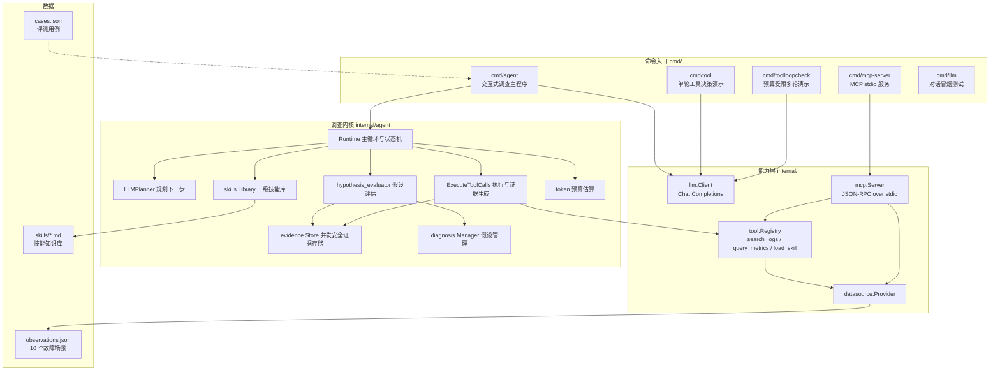
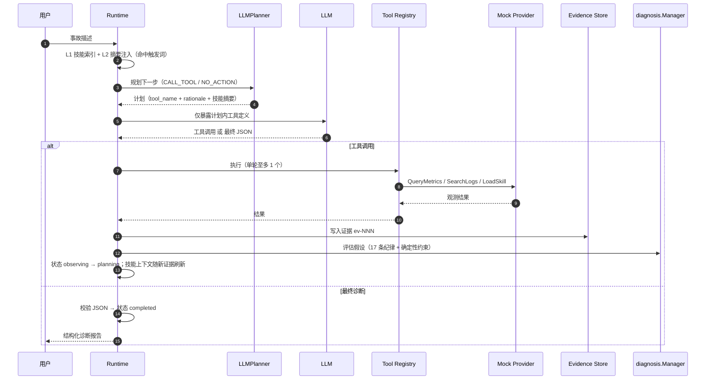

# TraceMind

> 一个基于 Go 的**证据驱动（Evidence-Driven）故障诊断 Agent**：输入事故描述，Agent 在严格预算与计划约束下逐步调用工具收集证据，再让 LLM 在证据纪律约束下评估根因假设，最终输出可审计的结构化诊断报告。

TraceMind 不依赖任何 Agent 框架，核心调查循环全部手写（约 4,400 行非测试 Go，唯一第三方依赖是 `yaml.v3`）。数据源通过 `Provider` 接口可插拔，工具层同时支持 Function Calling 与 [MCP](https://modelcontextprotocol.io) 两种暴露方式；参考知识采用**三级技能加载机制**（L1 索引 / L2 摘要 / L3 按需全量），并带可配置的 token 预算。

## 特性

- **证据驱动，杜绝编造**：所有结论必须基于工具真实返回的观测；LLM 评估假设时受 17 条证据纪律约束（区分观测与解读、禁止仅凭相关性断定因果、假设 ID 必须对应真实证据等）。
- **调查纪律强制**：显式状态机（`pending → planning → executing → observing → completed/failed`）；单轮至多执行 1 个工具调用；模型只能调用当前计划允许的工具，违规调用整轮拒绝执行并补齐协议响应；工具调用失败同样计入预算。
- **预算控制**：单次调查有 `max_tool_calls` 预算（默认 3），预算耗尽后不再向模型暴露工具定义，强制只出最终诊断。
- **LLM 调用韧性**：429/5xx/网络错误带指数退避重试（最多 2 次）；规划器输出异常（非法 JSON、幻觉工具名、空 rationale 等）**优雅降级**为强制终局而不是整场失败；假设评估失败保留上一轮结果继续调查；模型输出的非严格 JSON（Markdown 围栏、大写 `True`/`False`/`None`、尾逗号）在终局诊断、规划器、假设评估三处统一修复容错。
- **结构化假设管理**：假设状态机（`proposed / supported / refuted / inconclusive`）、确定性约束校正（支持与反驳并存 → 强制 `inconclusive`）、证据引用完整性校验、基于标题哈希的稳定假设 ID。
- **三级技能加载机制**：`skills/` 下的 Markdown 技能带结构化 front-matter（`name` / `description` / `triggers` / `recommended_tools`）。L1 技能索引常驻上下文；L2 按事故描述与证据命中触发词注入 2-3 条摘要；L3 由模型通过 `load_skill` 工具主动加载全文，受 `maxLoadedSkills=2` 容量 + LRU 淘汰约束。技能内容是参考知识，明确不作为当前事故证据。
- **Token 预算**：可配置 `max_tokens` 硬上限，基于轻量估算（ASCII ≈ 4 字符/token、CJK ≈ 1 字符/token）累计消息历史与工具定义；超限立即关闭调查并强制最终诊断，防止上下文失控。
- **可插拔数据源**：`datasource.Provider` 接口（`QueryMetrics` / `SearchLogs`），内置基于 JSON 场景数据的 mock 实现，含服务名别名归一化、时间窗/指标名过滤、日志分词检索。
- **MCP 能力**：手写 JSON-RPC 2.0 over stdio 最小协议子集（`initialize` / `ping` / `tools/list` / `tools/call` / `shutdown`），任意 MCP 客户端可连接，工具注册即自动暴露（含 `load_skill`）。
- **可离线演示与评测**：内置 10 个故障场景数据集 + 带关键词断言的评测用例 + 一键批量评测脚本（`evals/run.ps1`）。

## 架构



### 调查主循环



## 目录结构

```
TraceMind/
├── cmd/
│   ├── agent/            # 交互式调查主程序（推荐入口，支持 -skills 指定技能目录）
│   ├── mcp-server/       # MCP stdio 服务器，暴露工具层（含 load_skill）
│   ├── tool/             # 单轮工具决策演示（只打印模型的决定，不执行）
│   ├── toolloopcheck/    # 预算受限多轮工具循环演示
│   └── llm/              # 最小对话冒烟测试
├── internal/
│   ├── agent/            # 调查运行时：主循环、状态机、规划器、工具执行、假设评估、
│   │                     #   技能上下文组装、token 预算
│   ├── skills/           # 三级技能库：front-matter 解析、触发词匹配、LRU 加载预算
│   ├── config/           # YAML 配置加载（config.local.yaml 密钥覆盖）
│   ├── datasource/       # Provider 接口与查询类型
│   │   └── mock/         # 基于 JSON 场景数据的 mock 实现
│   ├── diagnosis/        # 假设模型与并发安全管理器
│   ├── evidence/         # 证据模型与并发安全存储
│   ├── llm/              # OpenAI 兼容 Chat Completions 客户端
│   ├── mcp/              # MCP 协议层（JSON-RPC 2.0 over stdio）
│   └── tool/             # 工具接口、注册表与内置工具（含 load_skill）
├── evals/
│   ├── datasets/         # observations.json（场景数据）、cases.json（评测用例）
│   ├── run.ps1           # 一键批量评测脚本
│   └── results/          # 评测结果示例（summary.json）
├── skills/               # 技能知识库：Markdown 排查手册（front-matter + 正文）
├── config.yaml           # 公开配置（不含密钥）
└── go.mod                # Go 1.23，唯一依赖 yaml.v3
```

## 快速开始

### 环境要求

- Go 1.23+
- 任意 OpenAI 兼容 Chat Completions API（默认 [DeepSeek](https://platform.deepseek.com)，可通过 `base_url` / `model` 切换）

### 1. 配置 API Key

`config.yaml` 是公开配置（可提交），密钥放在同目录 `config.local.yaml`（已被 `.gitignore` 排除），加载时会自动用本地文件覆盖 `llm.api_key`：

```yaml
# config.local.yaml
llm:
  api_key: "sk-..."
```

### 2. 运行 Agent（交互式调查）

```bash
go run ./cmd/agent
```

输入事故描述，例如：

```
The order service frequently times out and returns HTTP 502.
```

也可以非交互运行，指定事故描述与场景：

```bash
go run ./cmd/agent \
  -incident "The order service frequently times out and returns HTTP 502." \
  -scenario connection_pool_exhaustion
```

Agent 会在终端打印每轮的工具调用与结果，最后输出完整 JSON 诊断报告（`incident`、`state`、`state_history`、`tool_calls`、`summary`、`hypotheses`、`evidence`、`plans`、`diagnosis_hypotheses`、`knowledge`——`knowledge` 记录实际使用过的技能与加载级别）。

### 3. 工具层演示

```bash
go run ./cmd/tool           # 单轮：模型决定调用哪个工具（不执行）
go run ./cmd/toolloopcheck  # 多轮：预算受限循环，演示预算耗尽后强制终局
```

### 4. 运行 MCP Server

```bash
go run ./cmd/mcp-server -scenario connection_pool_exhaustion
```

MCP Server **不需要 LLM 配置**（只执行工具）。它走 stdio 协议，`Serve()` 会阻塞等待 stdin 上的 JSON-RPC 消息——**在前台直接运行会一直“卡住”，这是设计行为**：它应当被 MCP 客户端拉起，或用管道喂消息验证：

```bash
# 用管道喂一条 initialize 消息验证握手
'{"jsonrpc":"2.0","id":1,"method":"initialize","params":{"protocolVersion":"2025-06-18","capabilities":{},"clientInfo":{"name":"cli","version":"0.0.1"}}}' |
  go run ./cmd/mcp-server -scenario connection_pool_exhaustion
```

接入任意 MCP 客户端，例如 Claude Desktop：

```json
{
  "mcpServers": {
    "tracemind": {
      "command": "go",
      "args": ["run", "./cmd/mcp-server", "-scenario", "connection_pool_exhaustion"]
    }
  }
}
```

### 5. 验证

```bash
go build ./...
go test ./...
go vet ./...
```

## 配置参考

| 字段                      | 默认值                        | 说明                              |
| ----------------------- | -------------------------- | ------------------------------- |
| `llm.api_key`           | （必填）                       | 放在 `config.local.yaml`，不提交到 Git |
| `llm.base_url`          | `https://api.deepseek.com` | OpenAI 兼容端点，自动去除尾部 `/`          |
| `llm.model`             | `deepseek-chat`            | 模型名                             |
| `agent.max_tool_calls`  | `3`                        | 单次事故调查的最大工具调用预算                 |
| `agent.timeout_seconds` | `60`                       | 单次调查整体超时（秒）                     |
| `agent.max_tokens`      | `0`                        | 单次调查的估算 token 硬上限；`<=0` 表示不启用 |

## 数据集与评测

### 故障场景（`evals/datasets/observations.json`）

每个场景包含 `metrics[]`（服务健康指标快照）与 `logs[]`（结构化日志），供 mock Provider 读取。共 10 个场景：

| 场景 ID                          | 说明                         |
| ------------------------------ | -------------------------- |
| `connection_pool_exhaustion`   | 连接池耗尽：订单服务 P99 升高、HTTP 502 |
| `cpu_spike`                    | CPU 尖峰：服务变慢、错误率上升          |
| `downstream_timeout`           | 下游依赖（payment-service）超时    |
| `database_slow_query`          | 数据库慢查询                     |
| `redis_latency`                | Redis / 缓存访问延迟             |
| `traffic_spike`                | 流量尖峰导致网关与订单服务退化            |
| `high_errors_normal_resources` | 高错误率但资源正常（业务校验类错误）         |
| `conflicting_signals`          | 信号矛盾：日志称连接池耗尽但指标健康         |
| `insufficient_evidence`        | 证据不足：模型应明确不确定性             |
| `multiple_anomalies`           | 多异常叠加：CPU 与连接池同时升高         |

### 评测用例（`evals/datasets/cases.json`）

每个 case 声明事故描述、`expected_keywords`（诊断必须命中的关键词）、`forbidden_keywords`（诊断不得出现的错误结论）与 `expected_tool_calls_max`（预算上限），用于对 Agent 输出做断言式评测。`evals/results/summary.json` 是示例运行结果（命中/得分/工具调用数/状态）。

在项目目录运行以下命令即可跑所有 case（会逐条调用真实 LLM，请先配置 API Key）：

```
powershell -ExecutionPolicy Bypass -File .\evals\run.ps1
```

脚本设置 `$ErrorActionPreference=Continue`：单个 case 的 stderr 输出（如部分报告、降级告警）不会中断评测，每个 case 都会先写入 `results/<case>.log` 再判定退出码，失败 case 计入 CSV/JSON 汇总后继续下一个。

### 技能知识库（`skills/*.md`）

技能取代了早期的被动 RAG 检索：不靠文本相似度“猜”相关文档，而是三层渐进式接入模型上下文。

每个技能文件是一个带结构化 front-matter 的 Markdown 手册：

```markdown
---
name: connection_pool
description: 排查数据库连接池耗尽导致的请求超时、连接获取失败与 502
triggers: connection pool, connection_pool, 连接池, 连接耗尽
recommended_tools: query_metrics, search_logs
---

# 连接池耗尽导致请求超时

## 调查步骤
...
```

三级加载机制：

| 级别 | 触发方式 | 内容 | 成本 |
| --- | --- | --- | --- |
| L1 索引 | 常驻 | 所有技能的名字、描述、触发词一行一条 | 固定且极小 |
| L2 摘要 | 事故描述/证据命中触发词 | 命中技能的描述 + 推荐工具（最多 3 条） | 小，随轮次刷新 |
| L3 全量 | 模型调用 `load_skill(name)` | 完整排查步骤注入后续轮次 | 大，受预算约束 |

L3 的约束：

- **容量上限**：`maxLoadedSkills = 2`，超出按 LRU 淘汰最早加载的技能。
- **加载预算**：`load_skill` 是一个普通工具，同样受单轮单工具、计划强制与 `max_tool_calls` 预算约束。
- **证据隔离**：技能内容属于参考知识，工具执行结果带 `evidence=false`，不进入当前事故的证据存储；系统提示与技能上下文均明确“技能不是当前事故的观测，禁止当作根因证明”。

`internal/skills` 的 `Library.Match` 采用大小写不敏感的包含匹配，中英文触发词均可命中；`Library.Index()` 生成 L1 常驻清单。

## 核心设计

### 调查循环与状态机

每次事故调查创建独立的证据存储与假设管理器。状态机：`pending → planning → executing → observing → … → completed/failed`，终态不可再迁移，完整迁移历史写入报告（`state_history`）。整体轮数上限为 `max_tool_calls + 4`（预算内的工具轮 + 收尾诊断轮）。

### 规划器（LLM Planner）

`LLMPlanner` 每轮单独调用 LLM 决策下一步，只返回 JSON 计划（`action: CALL_TOOL | NO_ACTION`、`tool_name`、`rationale`、`target_hypothesis_id`、`expected_observation`），**规划与执行分离**：模型只负责提计划，工具是否执行由 Runtime 校验。规划输入包含当前证据、假设列表、各工具已调用次数与技能摘要（L2/L3 命中项）；`NO_ACTION` 触发强制终局。`Planner` 是接口，可替换为规则规划器或离线策略。

### 计划强制与预算

- 每轮只向模型暴露计划内单个工具的定义，其余工具不可见。
- 模型调用不符合计划 → 本轮全部调用拒绝执行，并为每个调用补齐协议响应，要求按计划或直接终局。
- 单轮至多执行 1 个调用；**执行失败也计入预算**，防止失败重试绕过预算。
- 预算耗尽后：不再提供工具定义、拒绝执行任何工具调用，只要求基于已有证据输出最终诊断。
- **Token 预算**：每轮用轻量估算（ASCII ≈ 4 字符/token、CJK ≈ 1 字符/token）累计消息历史与工具定义；超过 `max_tokens` 时打印告警、清空工具定义并强制终局，若已处于终局态仍超限则直接失败。估算器是确定性近似，用于硬上限控制，不追求与具体分词器一致。
- **异常降级**：规划器返回的模型输出错误（`ErrPlannerDegraded`）不会终止调查，而是打印告警并直接进入终局；假设评估失败时保留上一轮评估结果继续调查。配置类错误（无工具、客户端未配置等）仍会明确失败，避免掩盖真实问题。

### 证据与假设评估

工具结果先写入证据存储（ID 重编为 `ev-001` 起，重复 ID 拒绝，并发安全），再触发假设评估。评估提示词含 17 条纪律，例如：观测不等于指令、高利用率不等于已耗尽、时间邻近不等于因果、`supported` 不代表因果已证实、不得引用不存在的证据 ID、禁止 Markdown 围栏等。

评估结果进一步经过**确定性约束**校正（`constrainHypothesisAssessment`）：

- 同时含支持与反驳证据 → 强制 `inconclusive`，置信度上限 0.5；
- 声明 `supported` 但无支持证据 → 降级为 `proposed`（或有反驳则 `inconclusive`）；
- 新假设 ID 由标题哈希生成（`hyp-` + SHA-256 前 4 字节），保证同一假设跨轮保持身份稳定；模型重复使用已有 ID 指向不同标题时会被拒绝覆盖。

### 技能上下文组装

`internal/agent` 的 `buildSkillContext` 负责把 L2 摘要与已加载的 L3 全文拼成每轮的技能上下文；`skillLoader` 实现容量 + LRU 淘汰；`Report.Knowledge` 记录实际使用的技能与级别（`summary` / `full`），供报告审计。技能上下文随新证据每轮刷新（重新命中触发词），已加载技能在容量内保持。

### MCP 能力

`internal/mcp` 手写实现 MCP（2025-06-18 协议版本）的 stdio 传输子集，**不依赖任何 MCP 库**：

| 方法                          | 类型           | 说明                       |
| --------------------------- | ------------ | ------------------------ |
| `initialize`                | request      | 握手：返回协议版本、能力（tools）、服务信息 |
| `notifications/initialized` | notification | 握手完成通知                   |
| `ping`                      | request      | 存活检查                     |
| `tools/list`                | request      | 列出工具（schema 直接投影自工具注册表）  |
| `tools/call`                | request      | 执行工具，返回结构化内容             |
| `shutdown`                  | request      | 优雅退出                     |

实现要点：

- **传输**：stdio 上换行分隔的 JSON-RPC 2.0 消息（MCP stdio 帧格式，区别于 LSP 的 `Content-Length` 帧）。
- **错误码映射**：JSON-RPC 标准码 `-32700 / -32600 / -32601 / -32602 / -32603`，加 MCP 握手门 `-32002`（未完成 `initialize` 前拒绝除握手/ping/shutdown 外的请求）。
- **工具错误 vs 协议错误分层**：工具执行失败返回 `content` + `isError: true`（可交给模型继续推理）；协议违规才使用 JSON-RPC 错误码。
- **Schema 复用**：`tools/list` 的 `inputSchema` 直接投影自 `tool.Registry.ToLLMDefinitions()`，注册一个工具即同时获得 Function Calling 与 MCP 两种暴露——`load_skill` 注册后同样对 MCP 客户端可见、可调。
- **端到端测试**：`internal/mcp` 的测试用 `io.Pipe` 在同进程内驱动真实的 stdio 帧（握手 → 列工具 → 调工具 → 错误路径），不依赖外部进程。

### 可插拔数据源

`datasource.Provider` 只有两个方法：`QueryMetrics(ctx, MetricsQuery)` 与 `SearchLogs(ctx, LogsQuery)`。mock 实现从 JSON 读取场景数据，支持：

- 服务名别名归一化（`order` / `订单` → `order-service`，`mysql` / `database` → `database` 等）；
- 指标按 `Names` 过滤、按时间窗过滤、按时间升序返回；
- 日志按服务 + 时间窗 + 关键词检索（大小写不敏感、分词 ≥3 字符、停用词过滤）。

替换为真实数据源（Prometheus / OpenSearch 等）时，只需实现该接口，调查循环与工具层零改动。

## 测试

| 包                | 覆盖点                                                                                  |
| ---------------- | ------------------------------------------------------------------------------------ |
| `internal/agent` | 状态机迁移合法性；规划器校验（空工具/非法工具/未知假设 ID）；运行时主循环（计划强制、预算、证据编号、终局报告）；假设评估（确定性约束、证据引用校验、ID 稳定性）；技能加载器 LRU 淘汰与刷新；技能上下文组装（L2 命中/L3 全量/无命中不注入）；token 估算（ASCII/CJK/消息/工具定义）；韧性路径（规划器降级不失败、配置错误仍失败、终局 JSON 围栏容忍、JSON 修复：大写布尔/None/尾逗号且不改字符串内容） |
| `internal/skills`| front-matter 解析（含缺 name 报错）；重名与空目录报错；L1 索引内容；中英文/大小写触发词匹配；无命中；全量正文读取 |
| `internal/llm`   | 重试：429/5xx 重试成功、401 不重试、网络错误重试、上下文取消中断重试循环；可重试错误分类 |
| `internal/mcp`   | 协议端到端：握手、握手门、列工具、调工具、未知工具、非法参数、未知方法、解析错误、ping、shutdown                               |

```bash
go test ./... -v
```

## 已知限制与 Roadmap

- **数据源为 mock**：`Provider` 接口已就绪，真实数据源连接器待实现。
- **LLM 层仍较薄**：消息历史无上下文压缩，无流式输出，重试为固定策略（未读 `Retry-After` 响应头）。
- **技能检索为简单匹配**：`Library.Match` 是包含匹配，未做同义词/模糊扩展；技能库规模增大后 L1 索引的常驻成本会上升，可考虑按需裁剪。
- **token 估算为近似**：适用于硬上限控制；若要与模型真实计费对齐，应接入具体模型分词器。
- **MCP 仅 stdio 本地**：无鉴权/OAuth、无 streamable HTTP transport、无外部 server 注册中心（均为有意的范围裁剪）。
- **评测未接入 CI**：`evals/run.ps1` 已可一键批量评测，但依赖真实 LLM API，尚未接入 CI 与回归基线。
- **未添加 LICENSE**：开源前需补充。

## License

尚未添加。在添加 LICENSE 之前，保留所有权利。
